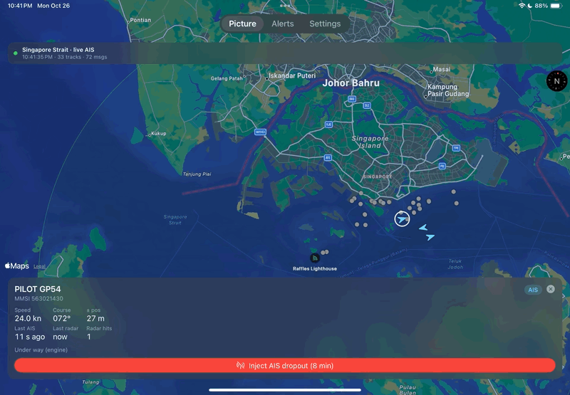
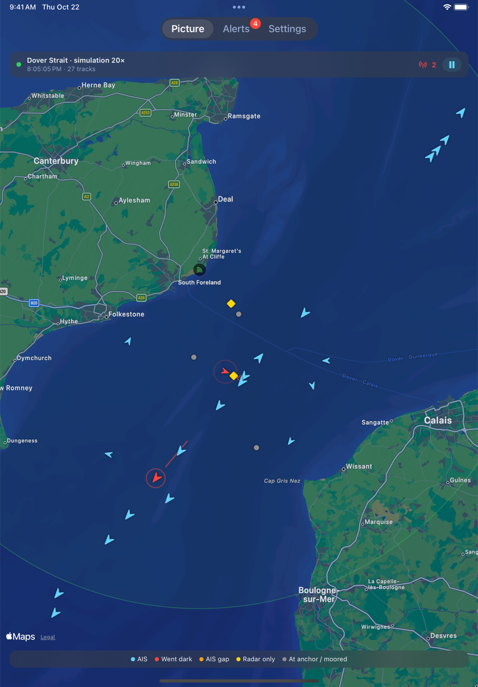
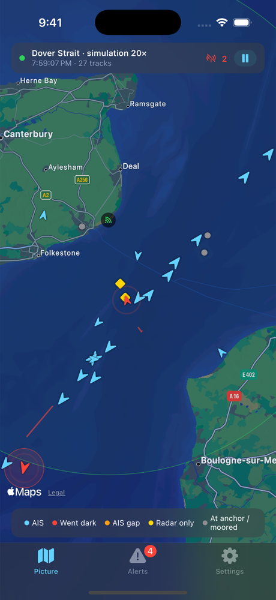
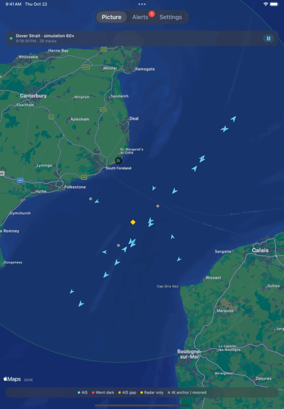

# Dark Wake

Dark Track, at sea. An iOS app that fuses two independent views of a stretch
of water into one tracked picture, then flags vessels that behave as though
they don't want to be seen:

- **AIS**: the cooperative source. Ships broadcast identity (MMSI, name,
  type), position, speed and course. Live from [aisstream.io](https://aisstream.io)
  or from the built-in simulator.
- **Coastal radar** (simulated): the non-cooperative source. It sees hulls,
  not names: noisy polar plots, a radar horizon that hides small boats
  sooner than ships, detection probability that falls with range, sea clutter.

A vessel that switches its AIS off while the radar keeps tracking it is the
maritime "went dark", and is the main thing this app is for. Ships do it to
hide illegal fishing, sanctions-busting ship-to-ship transfers and smuggling.

<p align="center">
  
</p>
<p align="center"><sub>Live AIS over the Singapore Strait on a real iPad (A16), 95 seconds sped up
4&times;. An AIS dropout is injected on MAERSK KARACHI, a container ship doing
about 7 kn, and it turns red once its AIS has been silent 61 s while the radar
still tracks it.</sub></p>

<p align="center">
  
  &nbsp;
  
</p>
<p align="center"><sub>Dover Strait simulation on iPad (A16) and iPhone 16 Pro. Blue arrows are
vessels reporting AIS; red ones have gone dark while the South Foreland radar
(green ring) still tracks them; yellow diamonds are radar contacts with no AIS
at all.</sub></p>

<p align="center">
  
</p>
<p align="center"><sub>Simulation: 25 seconds at 60&times;, about 19 simulated minutes. It opens with every
vessel on AIS; two of them switch AIS off partway through, are flagged red
within about a minute of simulated time, and the alert count climbs from 1 to 4.</sub></p>

## What it flags

| Alert | Rule |
|---|---|
| **Went dark** | AIS silent longer than max(60 s, 3x that vessel's own reporting interval), while radar has put a plot on the track in the last 30 s *and* on at least half the sweeps since AIS stopped. Anchored and moored vessels are excluded, as are vessels last seen at the edge of the feed's area. |
| **AIS gap (unconfirmed)** | AIS silent 10 min or more outside radar cover, where both the last fix and the dead-reckoned position are well inside the area, so the vessel didn't just sail out of it. |
| **AIS position jump** | Consecutive reports more than 2 km apart at an implied speed over 60 kn (spoofing or a misconfigured transponder). |
| **Dark rendezvous** | Two tracks held within 500 m for 5 min with their midpoint drifting under 2 kn, at least one of them dark or radar-only (a ship-to-ship transfer). |
| **Kinematic anomaly** | Kalman innovation beyond 4σ of the filter's own innovation std, twice in a row from one source (Dark Track's `kinematic_inconsistency`). |
| **No-AIS contact** | A confirmed radar track that has never had an AIS identity. |

## How it maps to Dark Track

| Dark Track | Dark Wake |
|---|---|
| `fusion/kalman.py` | `Core/KalmanFilter.swift`: constant-velocity filter, AIS SOG/COG fed in as a velocity measurement |
| `fusion/associate.py` | `Core/FusionEngine.swift`: covariance gate plus fixed radius, 3 km outer limit, NLL cost, Hungarian assignment per sweep (`Core/Hungarian.swift`) |
| `ingestion/radar_model.py` | `Core/CoastalRadar.swift`: one shore site, 4/3-earth horizon, range/azimuth noise, Pd(range, size), clutter |
| `anomaly/detectors.py` | `Core/AnomalyEngine.swift`: episode-based, so one dropout is one alert |
| `anomaly/inject.py` + `harness.py` | `Core/VesselSimulator.swift` (scripted bad actors + ground truth) and `Scorecard` in `Core/Pipeline.swift`; the in-app **Inject AIS dropout** button |
| OpenSky poller | `App/AISStreamClient.swift` + `App/LiveFeed.swift` |

## Measured

`swift test` runs 3 simulated hours in each of the four areas (Dover Strait,
Gibraltar, Singapore Strait, New York Bight). Each run has about 16 transiting
ships, 6 fishing boats, 3 at anchor, a go-fast boat and a no-AIS mothership,
plus scripted dark runs, rendezvous and AIS spoofing:

| | Result |
|---|---|
| Went dark, radar-visible | 87/88 (98.9%) |
| Median time to alert | 62–64 s |
| False went-dark alarms | 0 of 174 vessels |
| Dark rendezvous | 15/15 |
| AIS position jumps | 24/24 |

Two fixes got it there, both kept as comments in the code. First, every
early false alarm was a vessel leaving the area: its coasting track picked up
one stray plot minutes later. That is track seduction, not corroboration, so
the went-dark rule now needs radar on at least half the sweeps since AIS
stopped. Second, rendezvous started at 1/15, because two hulls 150 m apart
swap radar plots and their filter speeds jitter to 2–8 kn. "Stopped" is now
judged from the pair's midpoint drift over the window.

Five more dropouts started inside the 2 km edge band of their area, where
went-dark is switched off by design (a vessel going quiet there looks the
same as one leaving the feed's box). They are reported separately rather
than scored as misses, the way Dark Track's harness only scores what the
radar could reveal. The one real miss is a dark trawler that sat alongside
the mothership right next to the radar, where the two hulls' plots mixed.

These numbers come from this project's own simulator, so treat them as a
regression baseline, not a claim about real traffic.

**Live mode** was first run on a physical iPad (A16) on 2026-10-23, over the
Singapore Strait and New York Bight. It connected to aisstream.io and showed
real ships, and it exposed two bugs the simulator couldn't, because real AIS
arrives with irregular pauses and simulated AIS doesn't:

- Harbour tugs, pilot boats and a Staten Island ferry were flagged "went
  dark" after ordinary 60-second pauses in their AIS. The radar derived from
  AIS kept seeing a ship for 40 s after its last report, and 40 s plus the
  detector's 30 s radar recency exceeds the 60 s threshold. It now keeps
  that view for 15 s.
- Two dropouts injected in Upper New York Bay weren't flagged, because the
  New York Bight area put the harbour inside the 2 km edge band. The area
  now sits further north.

Both are reproduced by tests in `LiveTrackerTests.swift`, which replay a
real-style feed and failed before the fix.

Re-tested live after the fix on 2026-10-24 over the Dover Strait: a dropout
injected on a vessel under way at about 10 kn was flagged as went dark
53 s after injection (1/1), with no false alarms during the session. That
was one injection on a quiet late-night feed, so it shows the live path now
works end to end; it is not a detection or false-alarm rate.

A later Dover Strait recording on a very thin feed (36 messages in 2½ minutes
for 22 ships) injected a dropout on a ship whose real reports arrived only
every minute or two. The AIS-derived radar barely saw it, so the detector
rightly held off. That says nothing about detection, so injected dropouts are
now scored only if the radar had data on the ship for at least half the
sweeps while the injection ran (the same bar the detector sets). The rest are
listed in the app as "Not scored (radar had too little data)".

## Running it

**Tests** (no simulator needed):

```bash
swift test
```

**App:** open `DarkWake.xcodeproj` in Xcode 16 or later and run the
`DarkWake` scheme on an iOS 17+ simulator or device, or on *My Mac (Mac
Catalyst)*. If Xcode reports that no iOS simulator runtime is installed, add
one under Xcode › Settings › Components.

**Live AIS:** get a free key at aisstream.io, then in the app go to Settings ›
Live AIS, paste the key and tap *Apply and restart*. The key is stored in the
Keychain.

## Known limitations

- **In live mode the radar is derived from AIS.** A vessel that really
  switches AIS off also disappears from this radar, so real-world dropouts
  surface as *AIS gap (unconfirmed)*. The radar-confirmed path is tested
  with *Inject AIS dropout*, which hides a vessel's AIS from fusion while the
  radar keeps seeing it (the same approach as Dark Track's `inject.py`).
- That radar only keeps a moving ship in view for 15 s after its last real
  AIS report, and 15 s plus *Radar recency* has to stay under *Minimum AIS
  silence*. With the defaults that's 45 s under 60 s. Settings that break it,
  such as recency 50 s with silence 60 s, let ordinary AIS pauses look like
  a ship going dark.
- aisstream.io is terrestrial AIS, so coverage thins out offshore and quiet
  patches there are normal.
- The simulator knows nothing about land, so in some areas vessels cross it.
- Constant-velocity filter only (no IMM). Ships manoeuvre gently enough that
  this hasn't been a problem in simulation.
- Equirectangular local projection: fine across one radar's ~50 km
  coverage, not across an ocean.
